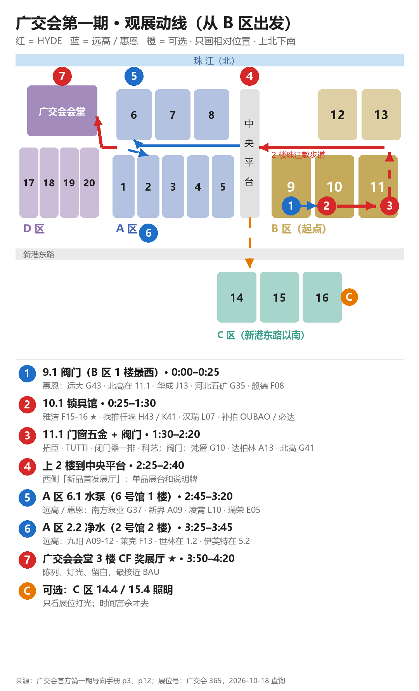

# 广交会 10-19 · 观展动线与拍摄指南（手机看）

**今天是第一期收展日，参展证到 10-19。** 门锁五金在 B 区 1 楼：10.1 锁具馆、11.1 门窗五金馆，两馆东西相邻。展位号来自广交会 365 官方搜索，10-18 查询。

**地图颜色**：红色站是 HYDE，蓝色站是远高、惠恩，橙色是可选。

**这一趟要带回来的三样东西：**

1. 照片和视频，标准见第三、第四节。
2. 每个重点摊位一句评语，写法见第五节。我最需要的是这个。
3. 传单和样册，每家一份。

## 一、时间表

**完整版约 4.5 小时**，三个网站一起看：

| 时间 | 站 | 在哪 |
|---|---|---|
| 0:00–0:25 | ① 9.1 阀门（惠恩） | B 区 1 楼最西，10.1 西隔壁 |
| 0:25–1:30 | ② 10.1 锁具（HYDE） | B 区 1 楼中间 |
| 1:30–2:20 | ③ 11.1 门窗五金 + 阀门 | B 区 1 楼东，10.1 东隔壁 |
| 2:25–2:40 | ④ 新品首发展厅 | 上 2 楼，珠江散步道往西，中央平台西侧 |
| 2:45–3:20 | ⑤ 6.1 水泵（远高、惠恩） | A 区 6 号馆 1 楼（A 区北排最西） |
| 3:25–3:45 | ⑥ 2.2 净水（远高） | A 区 2 号馆 2 楼 |
| 3:50–4:20 | ⑦ CF 奖展示厅 | A 区往西，广交会会堂 3 楼 |

**只有 3 小时**：去掉 ①⑤⑥，只走 ②③④⑦，其中 ③ 不看阀门。远高、惠恩的企业留到最后，有余力再补。

**提醒：**

- 开馆后头 30 分钟人最少，先去最重要的雅洁（10.1F15-16）；9.1 阀门可以放到 10.1 之后再回头。
- 每站结束看一眼时间。超时先砍 ⑥ 和可选站；HYDE 的 ②③④⑦ 不砍。

## 二、每站看谁、拍什么

### ② 10.1 锁具馆（65 分钟）

展位号字母越小越靠馆的一头。**按字母顺序走**，不走回头路：

- **C10-11 / B33-34 铁神锁业**：品牌企业，防火门锁、执手。看 5 分钟，拍正面和产品墙。
- **C33-34 / D13-14 OUBAO 瓯宝**：已拍过。补拍：上楣测试设备横幅的**正面**（站正，整条拍进去）、闭门器墙、型号牌特写。录一段闭门器演示门关门的视频（如果有）。
- **D11-12 / C35-36 梅花锁业**：锁芯。拍锁芯怎么摆（剖面、钥匙、分级）。
- **E35-36 / F11-12 必达 BE-TECH**：已拍过。补拍：人少时的正面全景，以及「IHG approved vendor」那块认证展板的特写。
- **F15-16 雅洁 YALIS ★ 本馆最重要，留 15 分钟**：广交会 CF 奖、高端建筑五金，BAU 的对标对象。第三节的 8 个机位全拍，再加 2 段视频：走进摊位、灯光上摇。
- **F45-46 名门锁业**：插芯锁。看 3 分钟。
- **H43 江门嘉铭、K41 温州安凯 ★ 找推杆墙**：看是不是 #09–#20 那面深色木纹板推杆墙（标识 UL Listed SA44924）。是的话：要一张名片；拍型号牌特写、板子背面怎么固定，量一块板的长宽；录一段按推杆的视频，听开启的声音、看回弹。
- **I35-36 / J13-14 无锡仟益**：品牌企业，闭门器、插芯锁。
- **K47 坚士**：执手。看执手墙怎么排。
- **L07 山东汉瑞 ★**：闭门器、合页、锁体、锁芯，全品类，和我们最像。重点看小展位怎么放这么多品类不乱，正面全景加每面墙正对各一张。

### ③ 11.1 门窗五金馆（50 分钟，含阀门）

- **D05-06 顶固**：品牌家居五金。只拍品牌形象墙和门头。
- **E33-34 / F13-14 广润、F11-12 / E35-36 星鹏**：品牌合页。拍合页怎么展示：开合角度、承重演示。
- **H07-12 / G35-40 拓臣 TOPCENT**：已拍过。补拍：上楣五条价值点的特写；洽谈区平面，步测长宽；「HINGE SOLUTIONS」分区牌。
- **H19-20 肇庆科艺**：玻璃门夹、地弹簧、闭门器。拍玻璃门五金实装：玻璃上的夹具、地弹簧怎么露出来演示。
- **H34-35 TUTTI**：已拍过。补拍：数字墙特写、「Regional Agents Wanted」立牌特写。拿一张传单。
- **I17-18 志盛门控、I19 海达门控、J20 敦豪斯、J25 欧德门控**：闭门器这一排一口气走完。每家看有没有能推的演示门，有就录一段 10 秒关门视频。
- **L25-26 富尔达**：闭门器、地弹簧、防火门。

### ④ 新品首发展厅（20 分钟）

上 2 楼，沿珠江散步道往西走到中央平台，展厅在平台西侧。

**看**：一个展台只讲一件产品时，展台、灯光、说明牌怎么做。

**拍**：

- 3 个你觉得最好的展台，每个拍正面一张、说明牌特写一张；
- 一张全厅。

### ⑦ CF 奖展示厅 ★（30 分钟）

沿 A 区 2 楼一直往西，到广交会会堂，上 3 楼。

**看**：留白、灯光、展台材质。最接近 BAU 要的「克制、专业」。

**拍**：

- 全厅横拍 2 张；
- 任意 5 个展台，每个正面一张、斜 45° 一张；
- 天花灯光一张；
- 展台材质（木、亚克力、金属、布）特写各一张；
- 一段 15 秒慢走视频。

### 可选（二选一，看剩余时间）

- **Ⓒ 照明馆，C 区 14.4、15.4**：从中央平台往南过天桥。**不是看灯，是看展位怎么打光。** 拍天花的轨道灯、灯带藏在哪、产品墙上的光斑。我们的金属五金反光，打光比平面设计更影响观感。
- **Ⓓ 安防用品，D 区 17.2**：门禁、电子锁、电磁锁。客户和我们是同一批门厂、工程商，看他们怎么讲认证和工程案例。

### 不用去

- **A 区家电（⑥ 2.2 净水除外），C 区摩托车、新能源，D 区机械、电子**：大品牌整馆特装，和 BAU 三面墙小展位不是一回事。
- **智慧生活专区（A 区 3.2、4.2，D 区 20.2）**：有智能门锁，但我们不卖。顺路就看 5 分钟，不顺路就算了。

### 远高、惠恩：①⑤⑥ 三站，和③里的阀门

**先说明**：远高是水处理网站。惠恩我这边没有产品资料，按你说的「水泵阀门」方向挑的。如果惠恩主营别的，告诉我，我重新查。

**① 9.1 阀门（25 分钟，B 区 1 楼最西）：**

- **G43 天津远大阀门 ★**：球阀、闸阀、蝶阀、过滤器、管件，品类最全。
- **J13-14 / I35-36 宁波华成阀门**：品牌企业。
- **G35-36 / H11-12 河北五矿**：品牌企业，球阀、蝶阀。
- **F08 般德阀门**：品类全。
- **H11-12 玉环华能叶轮**：品牌企业，球阀。

**③ 11.1 里的阀门（顺路）：**

- **G10-11 / F37-38 浙江梵盛流体**：品牌企业。
- **A13-14 / B09-10 达柏林阀门**：品牌企业。
- **G41-42 北京北高阀门**：品类全。

**⑤ 6.1 水泵（35 分钟，A 区 6 号馆 1 楼）：** 6.1 是水泵最集中的馆，品牌大厂多：

- **G37-38 / H11-12 南方泵业 ★**：离心泵、水处理。
- **A09-12 / B13-16 新界泵业 ★**：大品牌，展位大。
- **L10-12 / K37-39 凌霄泵业**：增压泵。
- **E05-06 / D43-44 瑞荣泵业**：离心泵、潜水泵、增压泵，品类全。
- **E21-22 / D27-28 福建爱的**：增压泵和净水器都有，和远高最近。
- **E17-18 / D31-32 丰球克瑞**：水处理泵。

**⑥ 2.2 净水（20 分钟，A 区 2 号馆 2 楼）：**

- **A09-12 / B13-16 九阳 ★**：CF 奖，净水器、过滤器。看家用净水怎么讲给消费者听。
- **F13-19 / E30-36 莱克**：CF 奖，净水器。
- 时间多可以去：**1.2B37 宁波世林**（净水器）、**5.2C18 伊美特**（反渗透、净水）。

**这三站拍什么（给远高、惠恩网站用）：**

- **剖面模型 ★**：水泵、阀门切开展示内部结构，这是这一行最有说服力的展示。每家有就拍正面一张、特写一张。
- **性能曲线和参数牌**：流量—扬程曲线、压力等级（PN16、Class 150）、口径。拍清楚，看他们怎么把数字讲给买家。
- **认证墙**：CE、NSF、WRAS、ISO，还有水表、阀门常见的检测标识。
- **应用场景**：农业灌溉、楼宇供水、家用净水、工业循环水，看他们用什么图、什么样板间。
- **净水的「过滤级数」展示**：透明滤芯、分层演示。
- **视频**：水泵运转演示（有水循环的展台），10–15 秒。

## 三、照片怎么拍（每个重点摊位 8 张）

**通用：**

- **横拍**，1 倍镜头，**不用 0.5 广角**（会变形）。
- **平视**，手机在胸口高度，不仰拍、不俯拍。
- **人少时拍**；有人就等 10 秒，或侧身避开脸。
- **先拍一张摊位号牌**，后面的照片我才对得上是哪家。

**8 个机位：**

1. **正面全景**：站在通道中间，退到整个摊位进画面。
2. **左 45°** 一张。
3. **右 45°** 一张：看出深度和侧墙。
4. **门头 / 上楣**：品牌、标语、认证 logo 拍清楚。
5. **每面产品墙正对**：墙要拍正，横平竖直。
6. **型号牌特写**：牌上写了什么（型号、标准、等级）。
7. **灯光**：抬头拍天花轨道灯、灯带。
8. **地面和台面材质**：木地台、地毯、台面、洽谈桌椅。

## 四、视频怎么录（每段 10–15 秒，横拍）

1. **走进摊位**：从通道慢慢走进摊位，手稳，不说话，看人进去先看到什么。
2. **横摇**：站在摊位中间，从左到右慢慢扫一圈，10 秒。
3. **灯光上摇**：从产品墙慢慢抬到天花，看灯和产品的关系。
4. **产品演示**：推杆按下去、闭门器关门、执手回弹。镜头对准产品，录到动作完整结束。

**注意：**

- 这些视频只作内部参考，不能剪进我们的宣传片。
- 尽量不录到别人的脸。
- 别人不让录就不录。

## 五、我要你培养的审美：每个重点摊位问自己 5 个问题

拍完一家，在手机备忘录写一行，例如：「雅洁 F15：3 秒看懂 是；乱 否；光 好；最想抄：型号牌」。

1. **3 秒测试**：站在通道上 3 秒，能不能说出这家卖什么、是谁？能，说明主次清楚；不能，说明东西太多或没有主角。
2. **一面墙一个主题吗？** 数一下一面墙有几类产品。超过 2 类基本就乱了。好的摊位每面墙只讲一件事：推杆墙就只有推杆。
3. **一致吗？** 展板颜色、型号牌格式、产品间距、灯色是不是全场统一。一致就是「有流程的工厂」，不一致就是「东拼西凑」。
4. **光对吗？** 产品亮还是背景亮？金属有没有刺眼的反光？灯色是不是一种（偏暖、偏白不要混）？好的展位产品比墙亮，墙比通道亮。
5. **能上手吗？** 客户能不能推一下、拧一下？能操作的样品比任何海报都让人信。

**再记一句**：这家最值得抄的一个细节，和最不该学的一个细节。

**为什么要你练这个**：我们的标准是「让谨慎的买家更愿意下单」，不是「好看」。BAU 的观众是建筑师和门厂采购，他们相信的是型号牌上的标准号、能按的推杆、对得上的尺寸，不是渐变色和大屏幕。你现场一句「这里乱」「这个光好」，比 20 张照片更有用，我设计时就按你的判断取舍。

## 六、要谁的目录（每家一份，拿不到就拍封面和目录页）

**HYDE：**

- 雅洁 ★
- OUBAO 瓯宝
- 山东汉瑞
- 铁神
- 梅花
- 富尔达
- TUTTI
- 拓臣 TOPCENT
- 推杆墙那家 ★

**远高：**

- 南方泵业
- 新界泵业
- 凌霄泵业
- 九阳（净水）
- 伊美特（反渗透）

**惠恩：**

- 远大阀门
- 北高阀门
- 梵盛
- 达柏林
- 华成
- 瑞荣泵业

**拿到目录后**：拍一张封面、一张目录页、一张产品页。我主要看三样：

- 分类怎么排；
- 每个产品页给哪些参数；
- 版式。

我们 HYDE 的广交会画册正在做，直接用得上。

## 七、我帮你补充的：顺便带回来的情报

你戴的是「境外采购商陪同人员」证，可以以采购方身份问问题。每家重点企业问这 5 个，记在备忘录：

1. **MOQ**：最小起订量多少。
2. **交期**：打样几天，大货几天。
3. **认证**：有哪些证书，能不能给证书编号。
4. **OEM**：能不能贴牌，包装能不能定制。
5. **主要市场**：出口哪些国家最多。

**问这 5 个的用处：**

- 我们网站上写的 MOQ、交期、认证，要放在同行旁边比，才知道有没有竞争力。
- 这些答案也决定 BAU 摊位上写哪几个数字。

**再留意 4 个趋势（拍到就行，不用专门找）：**

1. **表面颜色**：哑光黑、拉丝金、枪灰，各家主推什么。
2. **智能化**：普通五金摊位有没有加电子锁、门禁。
3. **认证标识**：有几家把 EN 标准、UL 号写在展板上。
4. **展台材料**：木纹板、金属网板、亚克力，哪种最多、哪种最显档次。

**照片怎么交给我（回来后）：**

- 每家先拍摊位号牌，后面跟着这家的照片，不用你分文件夹。
- 打包时把备忘录里的评语一起发我。

## 八、手上 72 张里现在能用的

**可以发**（新闻、LinkedIn，写「我们在广州、在广交会见客户」，**不能写参展**）：

- **#68**：主楼正面，没有人，最好。
- **#63、#64**：主楼加 140 届装置，裁掉人脸。
- **#44、#45**：140 届主背景板。
- **#51**：140 届 logo 墙。

**不能发：**

- **#71、#72 参展证**：有姓名、照片、二维码。
- **别家摊位、人群近景**：只作内部参考。

## 九、还需要的资料

**今天顺手拿到：**

- 每家的传单、样册（雅洁、TUTTI、OUBAO 最重要）。
- 推杆墙那家的名片。

**BAU 摊位（Halle C4 / Stand 523，三面墙，搭建方图纸已有）还缺：**

1. **现有展板的数量和尺寸**：拍一张展板全家福，量一块的长宽。
2. **打算带去的样品清单**：品类和型号。决定能不能做「推杆实装墙」和「一樘真门」。
3. **我们真有的证书**：CE、EN 1125、EN 179、EN 1906 等（ISO 9001:2015 已知）。上墙的只能是有原件的。
4. **10-16 喷绘那份还欠的三件事**：选墨色版还是白色版；三张天地轴图的原图；楣板公司名的拼写（图纸上写成了 "Hardward"）。

**回工厂补拍（网站和传单最缺）：**

- 车间、装配线：横拍。
- 测试设备，最好正在测我们的产品：盐雾箱、推杆 / 闭门器寿命测试机。
- 证书原件：平拍、无反光。
- 样品室、包装、装柜。

## 十、第二期才是我们的客户

- **第二期 10-23 至 10-27**：建筑装饰材料、卫浴、家具。门厂、门窗厂、工程采购都在这一期。
- **值得再办一张证**：看门厂怎么展示整樘门、五金怎么配，这正是 BAU「一樘真门」要学的。
- **第二期也有门控企业**：例如志盛门控 12.1B43、肇庆科艺 12.1E19、鑫普机电 12.1K02。
